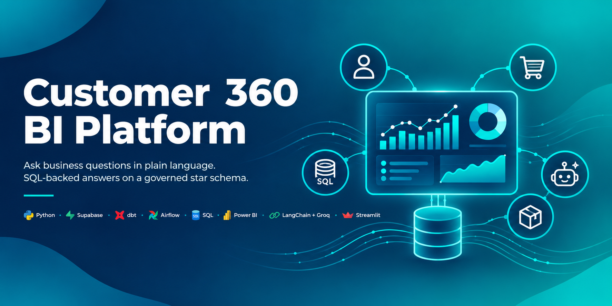
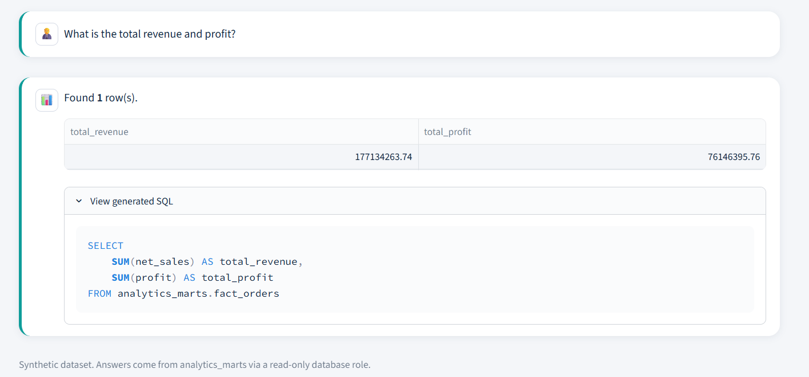
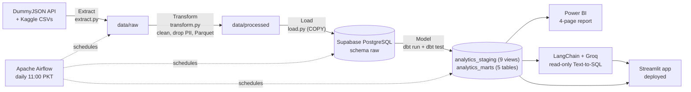
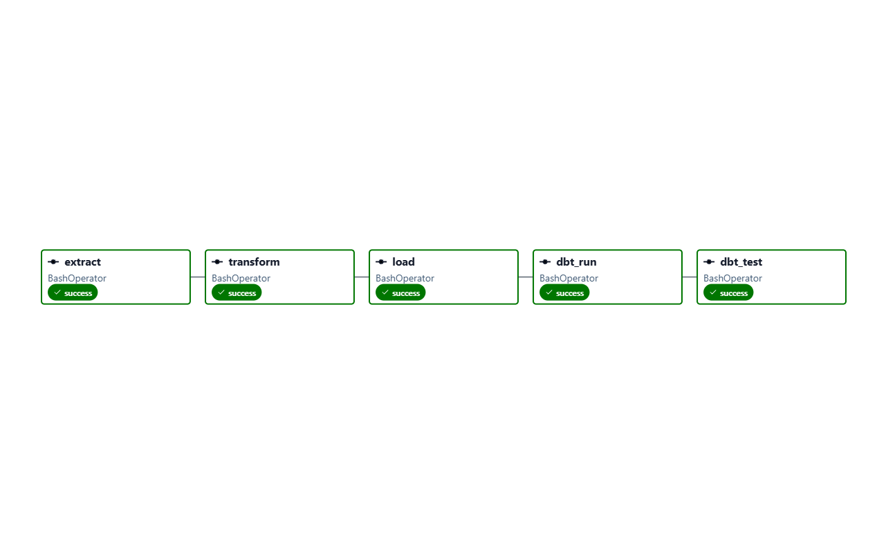
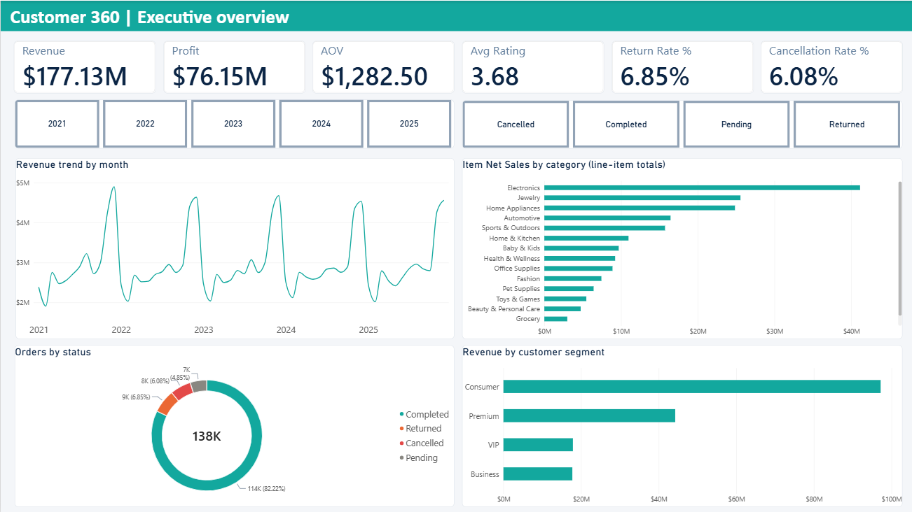
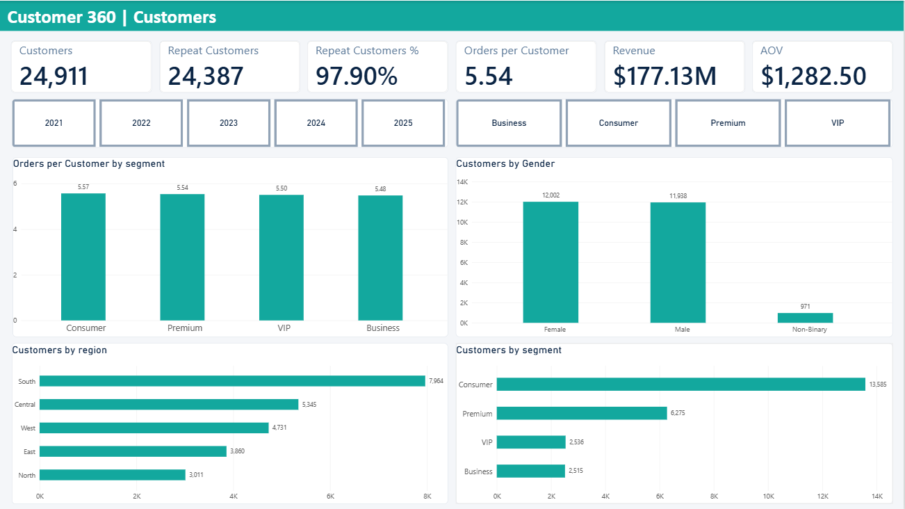
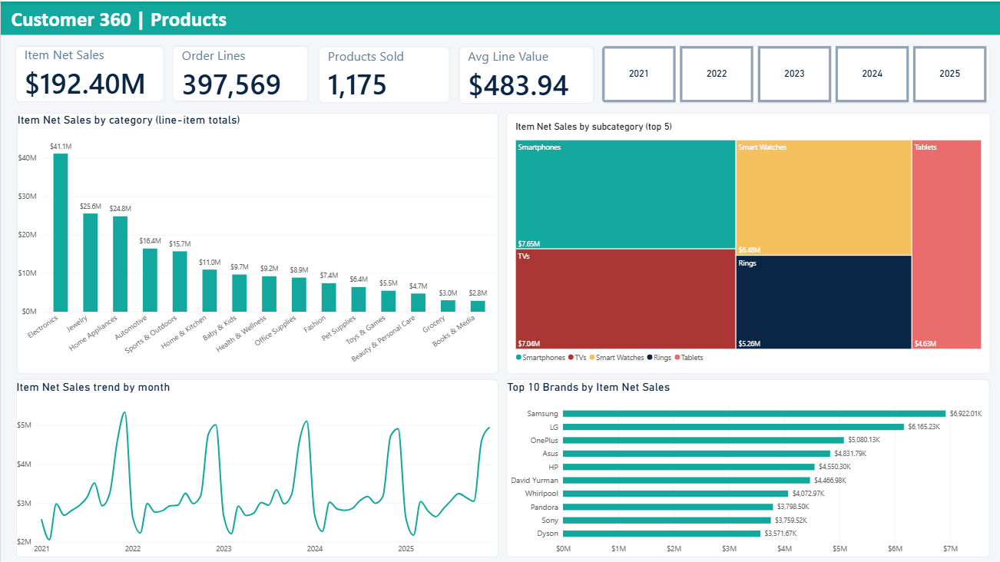
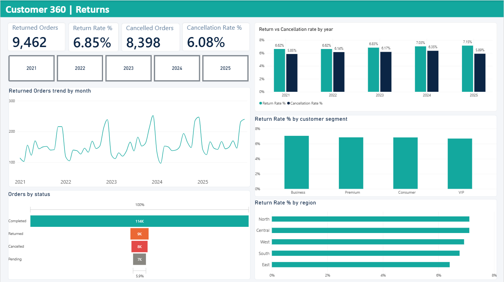

# Agentic Customer 360 BI Platform

End-to-end BI and AI platform: API + CSV ingestion, a Pandas transform layer, a Supabase (PostgreSQL) warehouse, dbt star-schema models with tests, Apache Airflow orchestration, a Power BI report, and a read-only Text-to-SQL AI agent deployed as a Streamlit app.

**Live demo:** https://agentic-customer360-bi-platform-b3idib58gw4qjtyks5uwh7.streamlit.app/





## Architecture



Pipeline type: hybrid ETL/ELT. Light cleaning and PII removal happen in Pandas before loading (ETL). Business logic lives in dbt after loading (ELT).

## Tech stack

| Stage       | Tool                                                    |
| ----------- | ------------------------------------------------------- |
| Extract     | Python, requests, Kaggle CSVs, DummyJSON API            |
| Transform   | Pandas, PyArrow (Parquet), PII removal                  |
| Load        | SQLAlchemy + psycopg2 (COPY) into Supabase (PostgreSQL) |
| Model       | dbt Core (dbt-postgres): star schema, tests, grants     |
| Orchestrate | Apache Airflow 3.3 on WSL2                              |
| Visualize   | Power BI Desktop (DAX)                                  |
| AI agent    | LangChain, Groq (`openai/gpt-oss-20b`)                  |
| Deploy      | Streamlit, Plotly, Streamlit Community Cloud            |

## Data sources

- **DummyJSON API** (web store): products, users, carts.
- **Kaggle E-Commerce Sales Analytics** (ERP-style data): 138,116 orders, 397,569 order lines, 25,000 customers, 1,175 products.

Tables are prefixed by source: `web_*` for the DummyJSON store, `erp_*` for the Kaggle sales system. The dataset is synthetic.

## Data model (dbt)

- **Staging** (`analytics_staging`, 9 views): one view per raw table, with typed columns (money as `NUMERIC(12,2)`) and meaningful NULLs preserved.
- **Marts** (`analytics_marts`, 5 tables): `dim_products`, `dim_customers`, `dim_date`, `fact_orders` (grain: one order), `fact_order_items` (grain: one product line per order, surrogate key `order_item_id`).
- **Tests:** 25 dbt tests (not null, unique, relationships, accepted values). Current result: 24 pass, 1 expected warning.
- **Grants:** `+grants` in `dbt_project.yml` gives the read-only agent role `SELECT` on every mart after each rebuild.

## Validated results

KPIs computed from `analytics_marts.fact_orders` match the source dataset statistics, the Power BI report and the AI agent:

| KPI                 | Value           |
| ------------------- | --------------- |
| Revenue             | $177,134,263.74 |
| Profit              | $76,146,395.76  |
| Average order value | $1,282.50       |
| Average rating      | 3.68            |
| Return rate         | 6.85%           |
| Cancellation rate   | 6.08%           |

### Known data quality issue

In 11,226 of 138,116 orders (8.1%), the sum of the order lines differs from the order header total (lines are always higher). The cause is in the source data. Order lines are kept and flagged with `is_order_reconciled`; all revenue, profit, AOV and return-rate KPIs are taken from `fact_orders`. This is the single expected warning in the dbt tests.

## Orchestration (Airflow)

The DAG `customer360_pipeline` (`dags/customer360_pipeline.py`) runs the same production scripts and dbt commands in order:

`extract -> transform -> load -> dbt_run -> dbt_test`

- Schedule: daily at 11:00 (Asia/Karachi).
- Retries: 1 retry, 2 minutes apart; the load task has a 20-minute timeout.
- Every task stops on the first failing command and loads the database settings from an environment file outside the repository.
- Airflow runs on WSL2 (Ubuntu) in its own virtual environment; the pipeline scripts and dbt run in a separate one so their dependency versions do not conflict.
- Limitation: Airflow runs only while the local machine and its terminal are on.



## Visualize (Power BI)

A 4-page report on the `analytics_marts` tables (star schema relationships, DAX measures in a separate measures table):

| Page      | Content                                                            |
| --------- | ------------------------------------------------------------------ |
| Overview  | Headline KPIs, revenue trend, orders by status, revenue by segment |
| Customers | Repeat customers, orders per customer, gender, region, segment     |
| Products  | Item net sales by category, subcategory and top brands             |
| Returns   | Return and cancellation rates by year, segment and region          |






Caveats: item-level net sales ($192.4M) is higher than order revenue ($177.1M) because of the known header/line mismatch, so revenue KPIs never use order lines. The Repeat Customer % depends on the year filter.

## AI agent (Text-to-SQL)

`src/agent.py` turns a plain-English question into one read-only SQL query, runs it and returns the result.

- **Model:** Groq `openai/gpt-oss-20b` through LangChain (the model name lives in one constant, so switching is a one-line change).
- **Schema prompt:** a compact description of the 5 marts plus business rules (for example, revenue comes only from `fact_orders`).
- **Guardrails, two layers:**
  1. Database role `agent_readonly`: `SELECT` on `analytics_marts` only; `raw`, staging, `DROP` and `DELETE` are rejected by PostgreSQL (tested). Statement timeout of 30 seconds.
  2. `validate_sql` in Python: a single `SELECT`/`WITH` statement, forbidden keywords rejected, 200-row cap, retry with backoff on rate limits.
- **Accuracy check:** the six headline KPIs and the yearly return rate generated by the agent match dbt and Power BI.
- **Limitations:** one question produces one query (multi-part questions can lose a part); Groq free-tier limits apply.

## Streamlit app

Deployed on Streamlit Community Cloud (secrets stored only in the cloud settings).

| Page                | Purpose                                                             |
| ------------------- | ------------------------------------------------------------------- |
| Home                | Headline KPIs and the architecture diagram                          |
| AI Analyst          | Chat with the agent, chart, table and generated SQL                 |
| Executive Dashboard | Filters (year, region, segment), KPI cards and Plotly charts, no AI |
| Data Explorer       | Star schema diagram, columns, row counts, sample rows               |
| Query Log           | Questions, status, latency and tokens for the current session       |

Limitations: the public app shares one Groq quota, and the free Supabase project pauses after a week of inactivity.

## Repository structure

```
src/                  extract.py, transform.py, load.py, agent.py (production scripts)
customer360_dbt/      dbt project (staging views, marts, tests, grants)
dags/                 Airflow DAG
app/                  Streamlit app (Home.py, shared.py, pages/)
.streamlit/           Streamlit theme (config.toml)
docs/images/          README images
requirements.txt      pinned Python dependencies
```

Notebooks (`*_explore.ipynb`) are for exploration only.

## Running it locally

1. Create a virtual environment and install the pinned dependencies:

```
python -m venv venv
venv\Scripts\activate
pip install -r requirements.txt
```

2. Put the Kaggle CSV files in `data/raw/kaggle/` and create a `.env` file in the project root with `SUPABASE_DB_HOST`, `SUPABASE_DB_PORT`, `SUPABASE_DB_NAME`, `SUPABASE_DB_USER` and `SUPABASE_DB_PASSWORD`. For the agent and the app also add `AGENT_DB_USER`, `AGENT_DB_PASSWORD` and `GROQ_API_KEY`.
3. Run the pipeline steps:

```
python src/extract.py
python src/transform.py
python src/load.py
```

4. Run dbt from `customer360_dbt/` with a `profiles.yml` outside the repository (it reads the same variables through `env_var()`):

```
dbt run
dbt test
```

5. Start the app:

```
streamlit run app/Home.py
```

`.env`, `data/raw/`, `data/processed/`, `venv/` and `.streamlit/secrets.toml` are never committed.

## Roadmap

- [x] Extract: DummyJSON API and Kaggle CSVs
- [x] Transform: Pandas cleaning, PII removal, Parquet
- [x] Load: Supabase (PostgreSQL), `raw` schema
- [x] Model: dbt star schema with tests
- [x] Orchestrate: Apache Airflow (daily schedule)
- [x] Visualize: Power BI report (4 pages)
- [x] AI agent: read-only Text-to-SQL with guardrails
- [x] Deploy: Streamlit Community Cloud
